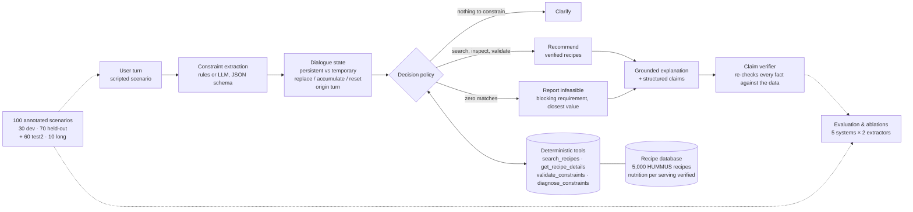

# recipe-agent

A conversational recipe assistant that extracts user requirements turn by turn, keeps them in
a structured dialogue state, checks every recommendation with deterministic tools, and
explains its choices with evidence from the recipe data. Built for NLP course Project 25
(University of Oulu, autumn 2025).

Research question: do structured memory and explicit tool use improve constraint satisfaction
as user requirements change during a conversation? Short answer from the held-out evaluation:
yes, and the two contributions are separable.

## Results

Held-out split: 70 scripted dialogues, 267 user turns, never used for tuning. The LLM extractor
is gpt-oss-120b (open weights) served by Lehmus AI; the policy, tools and explanations are the
same deterministic code in every row.

| System | Constraint satisfaction | Silent relaxations | Infeasible requests detected | Action accuracy | Tool calls / turn |
|---|---|---|---|---|---|
| Conversational RAG baseline (transcript retrieval, no state) | 0.248 | 237 of 267 turns | 0.00 | 0.884 | 1.0 |
| RAG + structured memory (no validation) | 0.911 | 24 | 0.00 | 0.884 | 1.1 |
| **Full tool-using agent** | **0.990** | **3** | **0.95** | **0.974** | 6.3 |
| Agent, memory switched off | 0.434 | 137 | 0.21 | 0.835 | 5.8 |
| Agent, validation switched off | 0.257 | 227 | 0.00 | 0.918 | 1.0 |

*Constraint satisfaction*: share of recommended recipes that satisfy every gold active
constraint. *Silent relaxation*: a recommend turn whose answer violates a stated constraint, or
where nothing could satisfy them. Unsupported factual claims: 0 of 25,000+ checked in every
configuration.

Constraint extraction on the held-out split: rules F1 0.936, LLM F1 0.968 (both 1.000 on the
30 development dialogues); dialogue-state exact match 0.783 vs 0.925. With the rules extractor
the full agent reaches 0.893 satisfaction and 29 relaxations. Every remaining relaxation of the
full agent sits on a turn where extraction had already produced a wrong state; with a correct
state the policy never relaxed a constraint. A second, independently written held-out set of
60 dialogues replicates the pattern (full agent 0.988, baseline 0.304). Details, ablations by
turn position and the optional extensions: [docs/evaluation_report.md](docs/evaluation_report.md).

## Architecture

One user turn flows left to right. The language model is used in one box only; every fact
comes from deterministic code.



## Setup

```
python -m venv .venv && .venv\Scripts\activate        # Windows
pip install -r requirements.txt
cp .env.example .env                                  # fill in the key(s) you use
```

The recipe database `data/processed/recipes.jsonl` (5,000 recipes) is in the repository. To
rebuild it, put the HUMMUS `pp_recipes.csv` under `data/pp_recipes/` and run
`python -m src.data_prep` (see [docs/data_notes.md](docs/data_notes.md)).

LLM providers for the extractor (`--provider`): `lehmus` (Lehmus AI, University of Oulu,
OpenAI-compatible; used for the final evaluation), `groq` (free tier; used for the pilot),
`anthropic` (Claude). The rule-based extractor needs no key.

## Running

```
python -m pytest -q                                   # 72 tests, ~30 s
python -m src.scenarios dev                           # validate scenarios, show feasibility per turn
python -m src.evaluate --split dev --extractor rules  # extraction F1 + dialogue-state accuracy
python -m src.evaluate --split dev --extractor llm --provider lehmus [--fresh] [--scenarios 10]
python -m src.run_agent --split dev --mode agent      # full agent: actions, satisfaction, claims, tools
python -m src.run_agent --split dev --mode rag | rag_memory
python -m src.run_agent --split dev --mode agent --no-memory | --no-validate   # ablations
```

`--split` is `dev`, `test` (70 held-out scenarios) or `test2` (a second, independently written
held-out set of 60 scenarios; see [scenarios/README.md](scenarios/README.md)). For example, the
rule-based results on the second held-out set:

```
python -m src.evaluate --split test2 --extractor rules [--no-memory]
python -m src.run_agent --split test2 --mode rag | rag_memory | agent [--no-memory | --no-validate]
```

`run_agent` writes a per-turn conversation log to `logs/` and metrics to `results/`;
`--errors` prints the turns with a wrong action or a violated constraint. LLM responses are
cached in `.cache/llm/` keyed by provider, model, prompt version and input, so re-runs are
free; `--fresh` bypasses the cache to measure real usage.

Try the agent in the browser (chat plus live dialogue state, decision, tool calls and grounding
check; switch between the five system configurations; replay dev scenarios turn by turn):

```
python -m src.demo                                    # http://127.0.0.1:7860, rule-based extractor
python -m src.demo --extractor llm --provider lehmus
```

Or from Python:

```python
from src.agent import Agent
from src.tools import RecipeDB
agent = Agent(RecipeDB.load())           # rule-based extractor by default
for turn in ["Suggest a vegetarian dinner.", "Under 25 minutes.", "Avoid mushrooms."]:
    print(agent.turn(turn)["message"])
```

## Optional extensions

```
python -m src.run_agent --split test --mode agent --ranking preference          # preference-based ranking
python -m src.run_agent --split dev --mode agent --extractor llm --provider lehmus --explain llm --review
python -m src.evaluate --split long --extractor rules                            # 8-12-turn dialogues, accuracy by turn
```

- **Preference-based ranking** (`--ranking preference`): inside the set of recipes that satisfy
  every constraint, rank by community rating plus a portion-sanity prior instead of popularity.
  Constraint satisfaction is unchanged; the recommendations get shorter preparation times and
  normal-sized servings (see `recommendation_quality` in the results).
- **Reviewer agent** (`--explain llm`, `--review`): the language model writes the explanation from
  the tool evidence, and a deterministic reviewer (`src/explain.py`) re-checks every number and
  every "meets all requirements" statement in the text against the tools. With `--review`, an
  unsupported claim makes the agent fall back to the templated answer. The results record how
  many claims were checked, how many were unsupported and how many turns were corrected.
- **Longer conversations** (`scenarios/long`, 10 dialogues of 8 to 12 turns): `evaluate.py`
  reports dialogue-state accuracy by turn position (`by_turn`).

## Layout

| Path | What |
|---|---|
| `src/data_prep.py` | HUMMUS exploration, filters, diet flags, ingredient categories, 5k sample |
| `src/schema.py` | Constraint / objective / turn-extraction schema |
| `src/extract_rules.py` | Rule-based extractor |
| `src/extract_llm.py` | LLM extractor (Lehmus / Groq / Anthropic), schema validation, cache, usage |
| `src/state.py` | Dialogue state: persistent vs temporary, replacement rules, provenance |
| `src/tools.py` | `search_recipes`, `get_recipe_details`, `validate_constraints`, `diagnose_constraints` |
| `src/agent.py` | Decision policy, baselines and ablation switches, grounded explanations, claim verifier |
| `src/explain.py` | Extension: model-written explanations and the reviewer that checks them against tool output |
| `src/evaluate.py` | Extraction and state metrics, memory ablation |
| `src/run_agent.py` | System-level metrics and conversation logs |
| `src/scenarios.py`, `src/author.py` | Scenario loading, validation, and the compact authoring format |
| `scenarios/` | 30 dev, 70 held-out, 60 second held-out (test2), 10 long dialogues; `README.md` has the annotation rules |
| `docs/` | Data notes, pilot summary, evaluation report |
| `results/`, `logs/` | Metrics and per-turn logs for every run in the report |
| `tests/` | Unit tests for every module |
