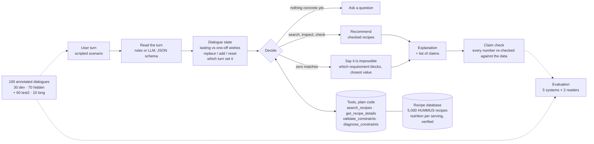

# recipe-agent

A recipe assistant the user can talk to. It picks up what the user wants turn by turn ("a vegetarian dinner", "under 25 minutes", "no mushrooms"), remembers it, searches 5,000 recipes, checks every candidate with plain code before suggesting it, and tells the user why it picked what it picked using the actual numbers from the data. If nothing fits, it says so and tells the user whichrequirement is the problem instead of quietly dropping one.

We built it for the NLP course project (Project 25:Conversational Recommendation Agent with Memory and Tool Use). The question we wanted to answer: does giving the assistant a structured memory and real tools make it follow the user's requirements better as they change during a conversation? It does, and memory and tool use each help for a different reason.

## Results

We tested on 70 scripted dialogues (267 user turns) that were not used while building the system. The LLM used to read the user's turns is gpt-oss-120b (open weights), served by Lehmus AI at the university. Everything else, search, checking, the decision logic and the
explanations, is ordinary Python and is the same in every row below.

| System | Constraint satisfaction | Silent relaxations | Infeasible requests detected | Action accuracy | Tool calls / turn |
|---|---|---|---|---|---|
| Plain RAG baseline (retrieval over the transcript, no state) | 0.248 | 237 of 267 turns | 0.00 | 0.884 | 1.0 |
| RAG + structured memory (no checking) | 0.911 | 24 | 0.00 | 0.884 | 1.1 |
| **Full agent** | **0.990** | **3** | **0.95** | **0.974** | 6.3 |
| Full agent with memory switched off | 0.434 | 137 | 0.21 | 0.835 | 5.8 |
| Full agent with checking switched off | 0.257 | 227 | 0.00 | 0.918 | 1.0 |

Constraint satisfaction is the share of recommended recipes that meet every requirement the user had stated at that point. A silent relaxation is a turn where the system recommended something that breaks one of those requirements, or recommended anything at all when nothing could have fit. Factual claims in the answers that turned out to be wrong: none, out of more
than 25,000 we checked.

A few more numbers. Reading the turns: the hand-written rules get F1 0.936 on the hidden dialogues and the LLM gets 0.968 (both score 1.000 on the 30 dialogues we tuned them on, which is exactly why the hidden set matters). Dialogue state exactly right after a turn: 0.783 with the rules, 0.925 with the LLM. With the rules reading the turns, the full agent lands at 0.893
satisfaction and 29 relaxations instead of 0.990 and 3. All of those relaxations happen on turns where the state was already wrong because of a reading error; whenever the state was right, the agent never dropped a requirement. A second set of 60 dialogues written independently by the
other team member gives the same picture (full agent 0.988, baseline 0.304).

The full write-up, including how accuracy changes over long dialogues and the three optional extensions, is in the project report submitted with this repository.

## How it works

One user turn goes left to right. The LLM only does the first step; every fact after that comes
from code.



## Setup

```
python -m venv .venv && .venv\Scripts\activate        # Windows
pip install -r requirements.txt
cp .env.example .env                                  # add the key(s)
```

The 5,000-recipe database (`data/processed/recipes.jsonl`) is in the repo. If anyone want to rebuild it, put the HUMMUS `pp_recipes.csv` under `data/pp_recipes/` and run `python -m src.data_prep`. What we found in the raw data and why we filtered it the way we did is in [docs/data_notes.md](docs/data_notes.md).

The LLM reader works with three providers (`--provider`): `lehmus` (Lehmus AI, OpenAI-compatible, what we used for the final runs), `groq` (free tier, what we used for the pilot) and `anthropic`(Claude). The rule-based reader needs no key at all.

## Walkthrough notebook and summary tables

The quickest way to see everything working is the notebook
[`notebooks/recipe_agent.ipynb`](notebooks/recipe_agent.ipynb), with one
section per project specification: it explores the data, validates the dialogues, runs the rule-based reader, the memory and the tools, chats with the agent (including an impossible request and a trade-off), re-runs the full agent on the hidden dialogues and shows the summary tables. It
runs offline without any API key, and it is saved with its outputs, so it can also be read on GitHub without running it.

```
jupyter notebook notebooks/recipe_agent.ipynb   # then Run All
python -m src.report      # summary tables of the data, dialogues and results, also saved as CSV in results/summary/
```

## Running things

```
python -m pytest -q                                   # 87 tests, about 30 s
python -m src.scenarios dev                           # validate the dialogues, show how many recipes match per turn
python -m src.evaluate --split dev --extractor rules  # how well turns are read, how often the state is right
python -m src.evaluate --split dev --extractor llm --provider lehmus [--fresh] [--scenarios 10]
python -m src.run_agent --split dev --mode agent      # the full agent: actions, satisfaction, claims, tool use
python -m src.run_agent --split dev --mode rag | rag_memory
python -m src.run_agent --split dev --mode agent --no-memory | --no-validate   # switch a part off
```

`--split` can be `dev`, `test` (the 70 hidden dialogues), `test2` (the second hidden set of 60) or `long` (10 dialogues of 9 to 12 turns). The annotation rules are in [scenarios/README.md](scenarios/README.md).

`run_agent` writes one log line per turn to `logs/` and the metrics to `results/`. Add `--errors` to print the turns where the action was wrong or a requirement was violated. LLM answers are cached in `.cache/llm/` (keyed by provider, model, prompt version and input), so re-running costs
nothing; `--fresh` ignores the cache to measure real usage.

There is also a small web page for trying it out. It shows the chat next to the live dialogue state, the decision, every tool call and the claim check, and lets the user switch between the five systems or replay a dev dialogue turn by turn:

```
python -m src.demo                                    # http://127.0.0.1:7860, rules reader
python -m src.demo --extractor llm --provider lehmus
```

Or straight from Python:

```python
from src.agent import Agent
from src.tools import RecipeDB
agent = Agent(RecipeDB.load())           # rule-based reader by default
for turn in ["Suggest a vegetarian dinner.", "Under 25 minutes.", "Avoid mushrooms."]:
    print(agent.turn(turn)["message"])
```

## Optional extensions

```
python -m src.run_agent --split test --mode agent --ranking preference
python -m src.run_agent --split dev --mode agent --extractor llm --provider lehmus --explain llm --review
python -m src.evaluate --split long --extractor rules
```

- **Preference-based ranking** (`--ranking preference`). Among the recipes that pass every requirement, rank by community rating plus a sanity check on portion size and cooking time, instead of popularity alone. Satisfaction stays the same (only the order changes); the suggestions get quicker and stop including 1,700-kcal "dinners". See `recommendation_quality`in the results files.
- **Reviewer** (`--explain llm`, `--review`). Let the LLM write the explanation from the tool evidence, then have a plain-code reviewer (`src/explain.py`) re-check every number and every "meets all your requirements" in the text against the tools. With `--review`, anything it cannot support makes the agent fall back to the templated answer. On 2,205 claims across dev and hidden dialogues the model got every number right; the reviewer, on the other hand, needed two rounds of fixes for its own false alarms. Details in the report.
- **Longer conversations** (`scenarios/long`). Ten dialogues of 9 to 12 turns. `evaluate.py` reports state accuracy by turn position (`by_turn`); the rules reader decays to 0.50 by turn 8, the LLM reader stays at 1.00.

## What is where

| Path | What |
|---|---|
| `src/data_prep.py` | HUMMUS exploration, filters, diet flags, ingredient categories, the 5k sample |
| `src/schema.py` | Constraint, objective and turn-extraction schema |
| `src/extract_rules.py` | Rule-based reader |
| `src/extract_llm.py` | LLM reader (Lehmus / Groq / Anthropic), schema validation, cache, usage counting |
| `src/state.py` | Dialogue state: lasting vs one-off wishes, replacement rules, which turn set what |
| `src/tools.py` | `search_recipes`, `get_recipe_details`, `validate_constraints`, `diagnose_constraints` |
| `src/agent.py` | Decision logic, baselines and the switches for ablations, explanations, claim check |
| `src/explain.py` | Extension: LLM-written explanations and the reviewer that checks them |
| `src/evaluate.py` | Reading and state metrics, memory ablation, accuracy by turn position |
| `src/run_agent.py` | System-level metrics and conversation logs |
| `src/scenarios.py`, `src/author.py` | Loading and validating dialogues, and the short text format we wrote them in |
| `src/report.py` | Summary tables of the data, the dialogues and the results |
| `notebooks/recipe_agent.ipynb` | Walkthrough of every specification, saved with outputs |
| `scenarios/` | 30 dev, 70 hidden, 60 second hidden (test2), 10 long dialogues; `README.md` has the annotation rules |
| `docs/` | Data notes and pilot summary |
| `results/`, `logs/` | Metrics and per-turn logs for every run mentioned in the report |
| `tests/` | Unit tests |
